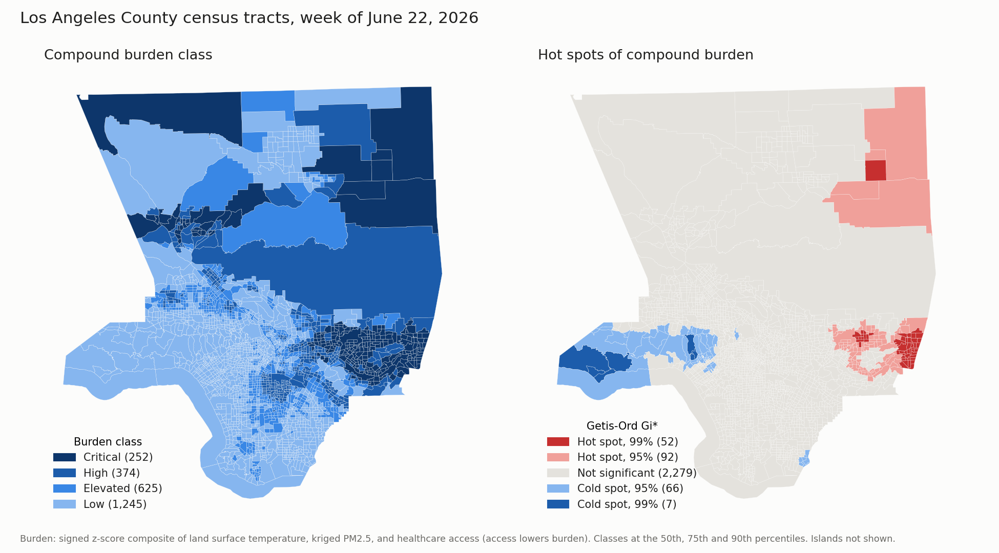

# CHBIndex: Compound Climate-Health Burden Index

A weekly geospatial pipeline that scores every census tract in Los Angeles County on compounded climate-health risk (extreme heat, fine particle pollution, and access to emergency care), finds where high burden clusters, and writes a short policy briefing for each high-burden tract that cites county and state guidance.

**Status: in progress.** The data, spatial, scoring, and briefing layers run end to end on real data for one week (June 22, 2026). Airflow orchestration, the API, and the dashboard are next. See [Status](#status).



## What it does

| Step | Method | Output for June 22, 2026 |
|---|---|---|
| Tracts and population | Census TIGER/Line and ACS 2024 5-year | 2,498 tracts, plus 1,228 neighboring tracts as a buffer |
| Fine particles (PM2.5) | EPA AQS daily data, ordinary Kriging to tract centroids | 21 monitors; LOO-CV MAE 0.81 µg/m³ |
| Heat | Landsat 8 and 9 land surface temperature via Earth Engine, water masked | 2,493 tracts, 31.5 to 55.6 °C |
| Emergency care access | Enhanced two-step floating catchment (E2SFCA) on a drive network | 2,475 tracts scored; median 2.10 beds per 1,000 |
| Health baseline | CDC PLACES adult asthma prevalence | used in briefings |
| Compound burden | Signed z-score composite; access lowers burden | 252 critical, 374 high, 625 elevated, 1,247 low |
| Clustering | Global Moran's I and Getis-Ord Gi* | Moran's I 0.879; 144 hot-spot tracts |
| Briefings | Retrieval over 5 policy documents, Claude Haiku 5.5 with structured output | one briefing per high or critical tract (626) |

All outputs are written per week and per city, so a rerun replaces that week instead of duplicating it. The same code writes to DuckDB locally or BigQuery and GCS in the cloud, chosen in config.

## Methods

### PM2.5: Kriging with an honest error estimate

There are only 21 regulatory monitors in and around the county, so tract values are interpolated with ordinary Kriging.

- Empirical variogram with equal-count distance bins (at least 30 pairs per bin, max lag half the largest monitor distance), fit with a weighted least-squares spherical model.
- The nugget has a floor set from the sampling noise of a weekly mean (with a finite population correction). A zero nugget made the surface pass exactly through every monitor and overfit.
- Leave-one-out cross-validation refits the variogram in every fold, so the held-out monitor never shapes the model that predicts it. I report MAE, not R², because R² over 21 points mostly reflects the spread between monitors.
- June 22 fit: nugget 0.307, sill 2.85, range 83.7 km, LOO MAE 0.81 µg/m³.

### Heat: land surface temperature

A 32-day Landsat 8 and 9 composite from Earth Engine, averaged per tract. Water pixels are masked with the QA water bit plus a majority-vote land mask. Before masking, ocean pixels pulled 39 coastal tracts about 14 °C cooler than their land. Tracts that are entirely water get no value.

### Access to emergency care: E2SFCA

- Supply: emergency departments from the California Department of Public Health (69 in LA County, plus 46 in neighboring counties within 30 km), weighted by beds.
- Demand: tract population, with origins at the Census 2020 population-weighted center of each tract, not the polygon centroid. Mountain tracts were dropping out because their centroids sat far from any road.
- Travel time: a drive network built from a Geofabrik OpenStreetMap extract (336,813 nodes, 854,792 edges), with origins snapped to the largest strongly connected component.
- Catchment: 30 minutes with a Gaussian distance decay (15-minute scale).
- Result: 3 tracts with no emergency department within 30 minutes (2,691 people), and 56 tracts whose nearest emergency department is in another county. Without the cross-county buffer those 56 would have looked far worse than they are.

### Compound burden score

Each component is standardized across the city and combined with a sign: heat and PM2.5 raise burden, access lowers it. Tracts are classed at the 50th, 75th, and 90th percentiles. Validation fails the run if burden rises with access.

I first used spatial PCA here. It put access on the burden side (correlation +0.86 with the first component), so the three emergency-care deserts scored LOW. PCA cannot be told which direction is bad, so it is kept only as a sensitivity check.

### Hot spots

Getis-Ord Gi* on the compound score, at 95% and 99% significance. Burden is strongly clustered (Moran's I 0.879): 52 tracts are 99% hot spots and 92 are 95% hot spots, mostly around Pomona and the eastern San Gabriel Valley, and in the eastern Antelope Valley.

### Policy briefings (RAG)

For each high or critical tract, the pipeline:

1. Picks the tract's risk drivers (any component in the city's worst quarter).
2. Retrieves up to 3 excerpts per driver from a ChromaDB store of policy documents (MiniLM embeddings, cosine distance cutoff 0.5, one excerpt per page so neighboring chunks of one page cannot fill the quota).
3. Sends the tract's numbers and the excerpts to Claude Haiku 5.5, which returns a typed briefing: summary, key risks, actions, and data gaps.
4. Drops any action that does not cite a retrieved excerpt, then checks the result: urgency matches the burden class, every action is cited, and the text does not talk about the scoring system.

The model does not set urgency. The pipeline does, from the burden class, and the prompt forbids changing it. Runs start with a stratified 25-tract sample that a person reads before the full week is generated, and the full run writes to the warehouse only if every tract succeeds.

The policy corpus: LA County Heat Action Plan (2026), California Extreme Heat Action Plan (2026), LA County Climate Vulnerability Assessment (2021), CDPH wildfire smoke guidance (2022), and the CARB technical advisory on reducing exposure near high-volume roadways (2017). Reference-list pages are skipped at ingest.

Example (tract 06037900102, critical, ranked 5 of 2,498):

> Mean land surface temperature is 55.61 °C, and the tract has 0.0 hospital beds per 1,000 residents within a 30-minute drive, so heat exposure and limited nearby hospital care both raise the risk for residents.
>
> **Actions**
> - Expand outreach about heat safety and promote access to cooling centers during extreme heat events. *[LA County Heat Action Plan, p. 10]*
> - Work with licensed health care facilities to advise on caring for patients during extreme heat, and monitor heat-related incidents they report. *[California Extreme Heat Action Plan, p. 44]*
> - Coordinate heat response across hospitals, clinics, community programs, and mobile units. *[LA County Heat Action Plan, p. 79]*
>
> **Data gaps:** no excerpt addresses PM2.5, asthma, or adding hospital capacity.

## Things that went wrong and what changed

- **Ocean pixels in the heat layer.** 39 coastal tracts read about 14 °C too cool until water was masked.
- **Overfit Kriging.** A zero nugget gave perfect fits at monitors and a misleading error. The nugget now has a floor from weekly sampling noise.
- **A false emergency-care desert.** One tract snapped to a road segment that could not reach the rest of the network. Snapping now uses the largest strongly connected component.
- **County lines.** 56 border tracts get their nearest emergency care in a neighboring county; a 30 km buffer of hospitals and population fixed their scores.
- **PCA pointed the wrong way.** See [Compound burden score](#compound-burden-score).
- **Briefings narrating the pipeline.** An early prompt asked the model to "explain" the urgency level, and 24 of 25 sample briefings said things like "the pipeline has set its urgency." The prompt and an automated check now prevent it.
- **Text lost from a PDF.** The CDPH guidance uses an invisible character as its word spacing, and the PDF parser dropped those passages. A parser upgrade and a cleaning fix took it from 97 to 360 chunks.

## Limitations

- Kriging uses distance only, so it misses terrain barriers (for example Lancaster, and Thousand Oaks and Simi Valley).
- Travel times are free-flow. They understate real drive times and overstate access near downtown freeway hubs.
- The heat layer is a 32-day composite, not a single week.
- AQS data lags by months, so PM2.5 is not real time yet.
- Large rural tracts dominate area maps like the one above. The dashboard will use H3 hexagons or population weighting.
- Briefings only know what the five policy documents say. Many tracts get similar actions, and asthma and hospital capacity often show up as data gaps.
- `median_income` of 250,001 is the ACS top code.

## Status

| Layer | State |
|---|---|
| Ingestion (TIGER/ACS, AQS, PLACES, CDPH hospitals, Landsat LST) | done |
| Kriging, LST processing, E2SFCA | done |
| Compound score, Gi* hot spots | done |
| RAG briefings, briefings table | done |
| Local DuckDB and BigQuery writes (idempotent per week) | done |
| Airflow DAGs (ingest, spatial transform, retrain, alerts) | next |
| 52-week backfill | next |
| ML: next-week risk model with spatial CV, calibration, equity audit | written, waiting on backfill |
| FastAPI serving, Streamlit and Deck.gl dashboard | planned |
| Second city (Chicago) | config exists, not run |

## Stack

Python 3.12 · GeoPandas · PySAL · OSMnx and pyosmium · rioxarray · Earth Engine · DuckDB · BigQuery and GCS · ChromaDB · sentence-transformers · Anthropic API · Apache Airflow 3.3 (Docker) · pytest

## Repository layout

```
config/          pipeline.yaml and one YAML per city
src/ingestion/   census_tiger, epa_aqs, cdc_places, hospitals, gee_lst
src/spatial/     kriging, lst_processing, healthcare_access, compound_score, hotspots
src/rag/         ingest_docs, vectorstore, retriever, briefing, risk_inputs, briefing_runner
src/ml/          features, spatial_cv, train, evaluate, calibrate, equity_audit
src/utils/       storage (DuckDB or BigQuery), GCS, OSM extract, config, logging
scripts/         build_corpus, run_briefings_week, plot_healthcare_access
airflow/ docker/ orchestration (in progress)
tests/
```

## Running the briefing step

Requires the local warehouse for the week, an `ANTHROPIC_API_KEY`, and the policy PDFs in `data/policy_docs/los_angeles/`.

```
python3 scripts/build_corpus.py                                   # embed policy PDFs, check retrieval
python3 scripts/run_briefings_week.py --week 2026-06-22           # 25-tract sample to review
python3 scripts/run_briefings_week.py --week 2026-06-22 --mode full --confirm-full
```

## Author

Sanket Bhusnoor, Research Scientist, Healthy Regions & Policies Lab, University of Illinois Urbana-Champaign.
