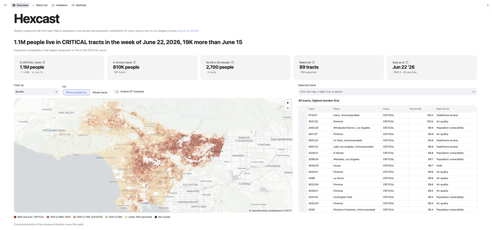
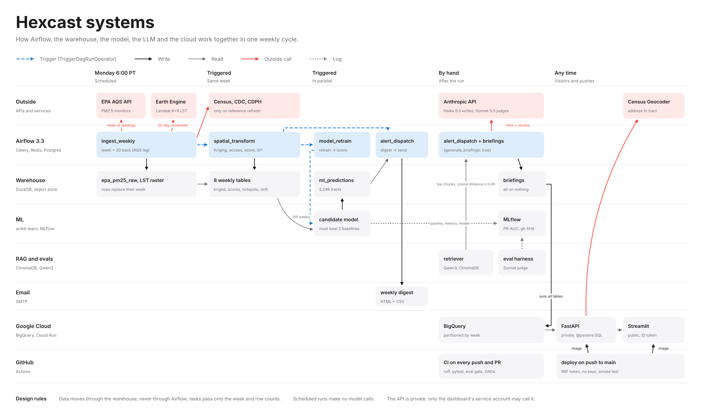
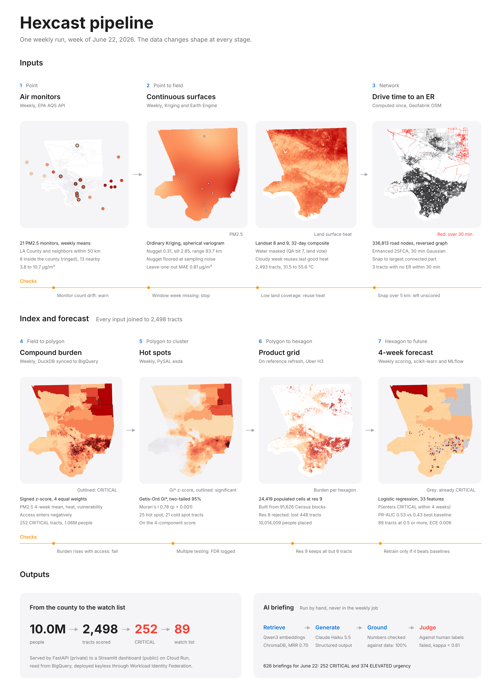
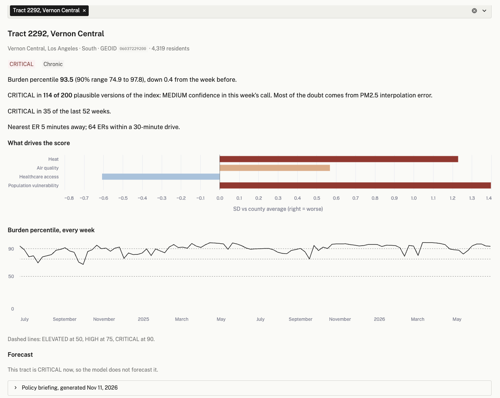
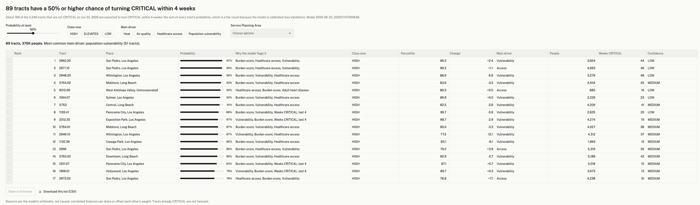

# Hexcast

**An end-to-end geospatial ML and LLM system for forecasting compound environmental risk.**

Airflow · Kriging · Gi\* hot spots · E2SFCA · H3 · scikit-learn / XGBoost / LightGBM · MLflow · RAG (ChromaDB, Qwen3 embeddings, Claude) · LLM evals · FastAPI · Streamlit · BigQuery · Cloud Run

**[Live dashboard](https://chbindex-dashboard-6zzxnzg2dq-uc.a.run.app)** · [Methods](docs/methods.md) · [Forecasting model](docs/ml.md) · [Evals](docs/evals.md) · [Decisions](docs/decisions.md)



Every week, Hexcast scores all 2,498 census tracts in Los Angeles County on four things that make heat and smoke more dangerous when they overlap: extreme heat, fine particle pollution (PM2.5), distance to emergency care, and who lives there. It flags tracts likely to turn CRITICAL within the next 4 weeks, and it writes a short policy briefing for each high-burden tract that cites county and state guidance. Two years of weekly data (105 weeks, June 2024 to June 2026) run through the same pipeline.

## Results

| Question | Answer | How it was checked |
|---|---|---|
| Who carries the burden? | 1.1M people (10.9% of the county) live in CRITICAL tracts in the week of June 22, 2026. Residents of the lowest-income third of tracts are 1.7 times as likely as residents overall to live in one; the highest-income third, 0.24 times. | ACS 2020-2024 income terciles, households and race/ethnicity counts |
| Does the index agree with California's own? | Rank correlation 0.67 with CalEnviroScreen; 78% of CRITICAL tracts are in its top quarter. | Weights were not tuned to match it ([why](docs/decisions.md#weights-left-alone-after-the-calenviroscreen-benchmark)) |
| Can it see trouble coming? | PR-AUC 0.53 for "enters CRITICAL within 4 weeks", against 0.43 for the best simple rule and 0.08 for random. In each week's top 50, 72% did turn CRITICAL. | Out of fold on 53,904 tract-weeks, later weeks and whole spatial blocks held out |
| Can the forecast be added up? | Brier 0.051 (0.074 for the base rate), expected calibration error 0.006. 169 tracts are expected to enter CRITICAL from June 22. | Calibration by decile |
| How good is the PM2.5 surface? | Leave-one-out MAE median 1.38 µg/m³ across 105 weeks, about 21 monitors a week | Variogram refit in every fold |
| Do the briefings stick to the data? | 626 of 626 briefings: every number matches the tract data, urgency matches the class, no talk about the pipeline. Median reading grade 10.2. | Code-based checks, no model calls |
| Does retrieval find the right policy pages? | Recall@3 0.38, MRR 0.70, every off-topic question rejected | Hand-labeled gold set; chose the embedding model |
| Can a planted excerpt hijack a briefing? | 10 of 10 prompt injections ignored; 4 of 5 unsafe planted excerpts left out | 30 live calls, $0.03 |

What did not work is reported too: the LLM judge did not agree well enough with human labels (mine, on 20 briefings) to be trusted on any criterion (weighted kappa under 0.61), so judge scores are not used as evidence ([details](docs/evals.md#a6-llm-as-judge)).

## How it works

<a href="docs/images/systems.png">
<picture>
  <source media="(prefers-color-scheme: dark)" srcset="docs/images/systems_dark.png">
  
</picture>
</a>

1. **Ingest.** PM2.5 from EPA AQS monitors in LA and neighboring counties, land surface temperature from Landsat 8 and 9 via Earth Engine, emergency departments from the California Department of Public Health, and tracts, ACS indicators and 2020 blocks from the Census Bureau.
2. **Spatial layers.** Ordinary Kriging turns about 21 monitors into tract PM2.5, with leave-one-out error every week. Landsat pixels are water-masked and averaged per tract. Enhanced two-step floating catchment (E2SFCA) on a 336,813-node drive network measures emergency care access, across county lines.
3. **Index.** A signed z-score composite: heat, PM2.5 (4-week mean) and vulnerability raise burden, access lowers it. Classes at the county's 50th, 75th and 90th percentiles. Getis-Ord Gi\* finds where burden clusters. A confidence layer reruns the index 200 times with correlated Kriging error and jittered weights.
4. **Forecast.** A calibrated logistic regression predicts which non-CRITICAL tracts enter CRITICAL within 4 weeks. Each prediction comes with its per-feature contributions. Retraining only promotes a model that beats two simple rules on held-out weeks; drift checks warn when inputs look unusual.
5. **Briefings.** For high-burden tracts, retrieval pulls policy excerpts per risk driver and Claude Haiku 5.5 returns a typed briefing. Any action without a retrieved citation is dropped. The pipeline, not the model, sets urgency.
6. **Serving.** Airflow writes DuckDB; a sync script mirrors it to BigQuery. A private FastAPI service on Cloud Run reads BigQuery, and only the dashboard's service account may call it. GitHub Actions deploys both with Workload Identity Federation, so no keys are stored.

One week of data, stage by stage, from monitor points to a 4-week forecast:

<a href="docs/images/pipeline.png">
<picture>
  <source media="(prefers-color-scheme: dark)" srcset="docs/images/pipeline_dark.png">
  
</picture>
</a>

Each step, its numbers and the alternatives I tried are in [docs/methods.md](docs/methods.md), with the component architecture diagram at the top.

## The dashboard

| | |
|---|---|
|  |  |
| **Tract panel.** Burden percentile with its 90% range, "CRITICAL in 114 of 200 plausible versions", what drives the score, and every week since June 2024. | **Watch list.** Tracts most likely to turn CRITICAL within 4 weeks, with the model's reasons, drivers and confidence. |

The map paints H3 hexagons (resolution 9) only where Census blocks have residents, so large empty tracts in the desert do not dominate the picture. Filters, selections and the week are stored in the URL, so any view can be shared as a link. The **Validation** page shows this week's data checks, the CalEnviroScreen comparison, the equity chart, model scores against baselines, calibration, and eval results.

## Things that went wrong and what changed

Each of these changed the code; the full stories are in [docs/decisions.md](docs/decisions.md).

- **PCA pointed the wrong way.** Spatial PCA put emergency care access on the burden side, so the three tracts with no ER within 30 minutes scored LOW. PCA cannot be told which direction is bad, so the index became a signed composite with a validation check that fails if burden rises with access.
- **Ocean pixels in the heat layer.** 39 coastal tracts read about 14 °C too cool until water was masked.
- **Overfit Kriging.** A zero nugget gave a perfect fit at every monitor and a misleading error. The nugget now has a floor from weekly sampling noise.
- **A false emergency-care desert.** One tract snapped to a road segment that could not reach the rest of the network.
- **Backfill scored out of order.** Airflow's mapped triggers ran 30 of 105 weeks out of week order, so their 4-week PM2.5 windows were short. A guard now raises when a window week is missing, and the rescore changed 6.5% of year-one CRITICAL tract-weeks.
- **Confidence that said everything could flip.** Independent Kriging errors said 98% of tracts could change class. Kriging errors are correlated in space; sampling the full error covariance gave a believable answer.
- **Briefings narrating the pipeline.** An early prompt made 24 of 25 sample briefings explain how their urgency was set. The prompt and an automated check now prevent it.

## Limitations

- Kriging uses distance only, so it misses terrain barriers (near Lancaster, Thousand Oaks and Simi Valley).
- Drive times are free-flow: they understate real trips and overstate access near downtown freeway hubs.
- Heat is a 32-day Landsat composite, not a single week. Cloudy weeks reuse the last good week.
- Regulatory PM2.5 arrives about 4 months late, so the newest weeks are not real time.
- Healthcare access for 2024-25 reuses the June 2026 hospital list.
- Briefings know only what 12 policy documents say, so many tracts get similar actions. The LLM judge is not validated, so briefing quality beyond the code-based checks rests on my own review of 20 briefings.
- Model reasons are the logistic regression's arithmetic, not causes: correlated features can share or offset each other's weight.
- The forecast catches fewer entrants in the highest-income third of tracts (9% of entrants in the weekly top 50, against 23% in the lowest third), where entering CRITICAL is much rarer.
- One county so far. The configuration is per city, and a Chicago config exists but has not been run.

## Running it

Requires Python 3.12, Docker, and keys for the Census API, EPA AQS and Anthropic (see `.env.example`). Earth Engine uses `earthengine authenticate`.

```
cp .env.example .env                                   # fill in keys
pip install -r requirements.txt
docker compose -f docker/docker-compose.yml up -d      # Airflow at localhost:8080
PYTHONPATH=. python -m pytest tests -q                 # 281 tests
```

Run a week through Airflow:

```
docker compose -f docker/docker-compose.yml exec airflow-scheduler \
  airflow dags trigger ingest_weekly_los_angeles --conf '{"week_start": "2026-06-22"}'
```

`ingest_weekly` triggers `spatial_transform`, which triggers `model_retrain` and `alert_dispatch`. Then serve it locally:

```
PYTHONPATH=. uvicorn src.serving.api:app                # API docs at localhost:8000/docs
streamlit run dashboard/streamlit_app.py                # dashboard at localhost:8501
```

Briefings are generated by hand, never on a schedule: `python scripts/run_briefings_week.py --week 2026-06-22` writes a 25-tract sample to review before `--mode full --confirm-full`.

## Repository layout

```
config/          pipeline.yaml and one YAML per city
airflow/         4 weekly DAGs plus a backfill DAG, spatial operators
src/ingestion/   AQS, Landsat LST, CDPH hospitals, Census TIGER/ACS/blocks, PLACES, CalEnviroScreen
src/spatial/     Kriging, LST, road graph and E2SFCA, composite, Gi*, confidence, chronic, H3 hexes
src/ml/          features, spatial CV, tuning, scoring, contributions, retrain, drift
src/rag/         corpus ingest, vector store, retriever, briefing, action plans
src/evals/       harness, retrieval, faithfulness, rules, specificity, judge, robustness, CI gate
src/serving/     FastAPI app, service, DuckDB and BigQuery stores, schemas
dashboard/       Streamlit app (Overview, Watch list, Validation, Methods)
scripts/         backfill, rescoring, ML comparison, evals, BigQuery sync, GCP setup
tests/           pytest suite, including a frozen eval gate that runs in CI
```

## Author

Mallikarjun (Sanket) Bhusnoor. Research Scientist at the Healthy Regions & Policies Lab (HeRoP), University of Illinois Urbana-Champaign.
