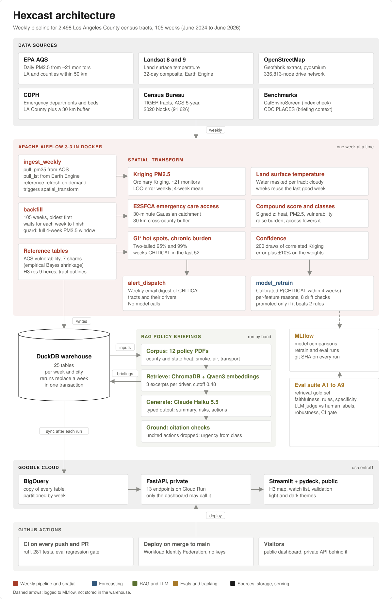

# Methods

How each layer of Hexcast is built, with the numbers that settled each choice. Back to the [README](../README.md).

- [Tracts, people and the study window](#tracts-people-and-the-study-window)
- [PM2.5: Kriging with an honest error estimate](#pm25-kriging-with-an-honest-error-estimate)
- [Heat: land surface temperature](#heat-land-surface-temperature)
- [Access to emergency care: E2SFCA](#access-to-emergency-care-e2sfca)
- [Population vulnerability](#population-vulnerability)
- [Compound burden score](#compound-burden-score)
- [Hot spots, chronic burden and confidence](#hot-spots-chronic-burden-and-confidence)
- [Policy briefings (RAG)](#policy-briefings-rag)
- [Weekly checks](#weekly-checks)
- [Map: H3 hexagons where people live](#map-h3-hexagons-where-people-live)
- [Orchestration, storage and serving](#orchestration-storage-and-serving)

## Tracts, people and the study window

- 2,498 census tracts in Los Angeles County (TIGER/Line), about 10.0M residents, plus 1,228 tracts in neighboring counties as a buffer for cross-county care.
- 105 weeks, Monday to Sunday, from June 24, 2024 to June 22, 2026. Every table is written per week and per city, and a rerun replaces its week instead of adding rows.
- Population comes from the ACS 5-year tables; Census 2020 blocks (91,626 blocks) place people inside tracts for drive-time origins and the hexagon map.

## PM2.5: Kriging with an honest error estimate

Only about 21 regulatory monitors in and around the county report in a given week, so tract values are interpolated with ordinary Kriging.

- Daily PM2.5 from EPA AQS for LA and neighboring counties within 50 km, averaged per monitor per week.
- Empirical variogram with equal-count distance bins (at least 30 pairs each, maximum lag half the largest monitor distance), fit with a weighted least-squares spherical model. A plot of the fit is saved every week.
- The nugget has a floor set by the sampling noise of a weekly mean, with a finite population correction. A zero nugget made the surface pass exactly through every monitor and overfit.
- Leave-one-out cross-validation refits the variogram in every fold, so the held-out monitor never shapes the model that predicts it. The error is reported as MAE: R² over 21 points mostly reflects how far apart the monitors are.
- Across 105 weeks the median LOO MAE is 1.38 µg/m³ (1.19 in the second year). The worst weeks are July 4 and the December 2024 to January 2025 fire weeks.
- The index uses a 4-week rolling mean of the Kriged values. With weekly values, only 59% of CRITICAL tracts stayed CRITICAL the next week; with the 4-week mean, 81%.

## Heat: land surface temperature

- A 32-day Landsat 8 and 9 composite from Earth Engine, averaged per tract.
- Water is masked with the QA water bit and a majority-vote land mask. Before masking, ocean pixels pulled 39 coastal tracts about 14 °C cooler than their land. Tracts that are only water get no heat value.
- When too few tracts have clear pixels (the weekly check flags under 95%), the week reuses the last good week's heat scores instead of scoring on clouds.

## Access to emergency care: E2SFCA

Enhanced two-step floating catchment measures how many emergency beds are within reach of each tract, after accounting for everyone else who shares them.

- **Supply:** emergency departments from the California Department of Public Health, weighted by beds: 69 in LA County plus 46 in neighboring counties within a 30 km buffer.
- **Demand:** tract population, with origins at the Census 2020 population-weighted center of each tract. Polygon centroids put mountain tracts far from any road, and they dropped out.
- **Network:** a drive network from a Geofabrik OpenStreetMap extract, parsed with pyosmium and OSMnx's drive filter (336,813 nodes, 854,792 edges). Origins snap to the largest strongly connected component; snapping to any road once left a tract on a segment that could not reach the rest of the network, and it looked like a desert.
- **Catchment:** 30 minutes with a Gaussian distance decay (15-minute scale). Travel times are computed on the reversed graph from each hospital.
- **Result:** 2,475 of 2,498 tracts scored (the rest are unreachable or have no residents). 3 tracts (2,691 people) have no emergency department within 30 minutes. 56 tracts have their nearest one in another county; without the buffer they would have looked far worse than they are.
- Access is in beds per 1,000 residents. Unscored tracts are missing values, not a sentinel number.

## Population vulnerability

The same heat or smoke hurts some groups more, so the index includes who lives in each tract. Seven ACS shares: people 65 and over, children under 5, income below 200% of the poverty line, households without a car, limited-English households, people without health insurance, and people with a disability.

1. Each share is shrunk toward the county mean by its own sampling noise (empirical Bayes, using the ACS margins of error). A precise share keeps its value; a noisy one moves toward the mean. Unlike a cutoff on the coefficient of variation, small but precise shares are kept.
2. Each shrunk share is z-scored, and the seven z-scores are averaged.
3. The weekly composite z-scores that average again, so vulnerability carries the same weight as each hazard.

The ACS changes once a year, so vulnerability is the same every week.

## Compound burden score

A signed z-score composite of four equal-weight components:

| Component | Direction |
|---|---|
| PM2.5, 4-week mean | higher means more burden |
| Land surface temperature | higher means more burden |
| Emergency care access | higher means **less** burden |
| Population vulnerability | higher means more burden |

Tracts are classed by county percentile: CRITICAL at the 90th and above, HIGH from the 75th, ELEVATED from the 50th, LOW below. That gives 252 CRITICAL tracts every week. A run fails validation if burden rises with access, if classes do not have the expected sizes, or if any tract is duplicated.

Spatial PCA was the first attempt and is now only a sensitivity check: it cannot be told which direction is bad ([story](decisions.md#a-composite-that-knows-which-way-is-bad)). Vulnerability is added to the hazards rather than multiplied with them, so a tract with high hazard and average vulnerability is still visible.

**External check.** Against CalEnviroScreen, California's cumulative pollution and population index: rank correlation 0.67, and 78% of CRITICAL tracts are in its top quarter. The weights were not tuned to match it.

## Hot spots, chronic burden and confidence

- **Hot spots:** Getis-Ord Gi\* on the compound score with two-tailed cutoffs at 95% and 99%. The false discovery rate count is logged, not used as the cutoff.
- **Chronic burden:** weeks CRITICAL in the last 52. A tract is chronic at 26 or more. The flag stays empty until a full 52-week window exists. In the week of June 22, 2026: 197 tracts, 810,396 people.
- **Confidence:** each week the index is recomputed 200 times. Each draw samples PM2.5 error from the full tract-by-tract Kriging error covariance (from that week's variogram, one draw shared by the 4 weeks in the PM2.5 window) and jitters every component weight by up to ±10%. The badge is about the decision that matters, CRITICAL or not: agreement is the share of draws that agree with this week's call. HIGH at 90% or more, LOW under 50%. In an average week, of the 252 CRITICAL tracts, 47.5 have HIGH confidence, 135.4 MEDIUM and 69.1 LOW. PM2.5 interpolation drives almost all of it: in June the tract-to-tract spread of PM2.5 (SD 0.59 µg/m³) is smaller than its interpolation error (SD 0.94).

## Policy briefings (RAG)

For tracts that are CRITICAL or HIGH, the pipeline:

1. **Picks drivers:** any component in the county's worst quarter, or the single highest if none is.
2. **Retrieves** up to 3 excerpts per driver from a ChromaDB store of 12 policy documents (county and state heat plans, CDPH wildfire smoke guidance, CARB roadway exposure, South Coast AQMD air filtration programs, Medi-Cal transportation, language access and others). Embeddings are Qwen3-Embedding-0.6B with a task instruction on queries; a cosine distance cutoff of 0.48 drops off-topic results; only one excerpt per page is kept, so neighboring chunks of one page cannot fill the quota. Both the embedding model and the cutoff were chosen on a hand-labeled gold set ([evals](evals.md#a1-retrieval)). A cross-encoder reranker was tested on the same set and is not used.
3. **Writes** one action plan per driver combination, plus per-hazard actions for the tract's vulnerable groups, and a per-tract summary. Claude Haiku 5.5 returns typed output through the Anthropic SDK's structured parsing: summary, key risks, actions with excerpt IDs, and data gaps.
4. **Checks:** any action citing an excerpt that was not retrieved is dropped. The pipeline sets urgency from the burden class, and the prompt forbids changing it or describing how it was set.

Runs start with a 25-tract stratified sample that I read before the full week is generated, and the full run writes only if every tract succeeds. Briefings are generated by hand, never on a schedule, and the dashboard only reads them. Every model call in the project, briefings and evals included, fit inside a $5 API budget.

## Weekly checks

Eight checks compare each week with the trailing 8 weeks. They warn and never stop the pipeline; thresholds were set on the 2024-2026 history so each fires on roughly the most unusual 5 to 10% of weeks.

| Check | Flagged when |
|---|---|
| CRITICAL list overlap with last week | Jaccard below 0.45 |
| Kriging error | above 1.5 times the trailing median |
| Tracts with clear heat pixels | below 95% |
| Heat countywide level | beyond ±2 SD |
| Heat spatial pattern | PSI above 0.10 |
| PM2.5 monitors reporting | off the trailing median by 10% |
| PM2.5 countywide level | beyond ±2 SD |
| PM2.5 spatial pattern | PSI above 0.5 |

Level and pattern are separate on purpose: a PSI on raw values flagged every week, because the whole county's level moves with the weather ([story](decisions.md#drift-checks-that-do-not-cry-wolf)).

## Map: H3 hexagons where people live

Area maps let big, empty desert tracts dominate. The dashboard paints H3 resolution 9 cells only where Census 2020 blocks have residents (24,419 cells, all 10,014,009 people), each colored by the tract holding most of its people. At resolution 8, 448 small, dense tracts (1.38M people) were never a cell's main tract and disappeared from the map; at resolution 9, 6 tracts (10,250 people) do. Whole-tract fill is one click away.

## Orchestration, storage and serving

- **Airflow 3.3** in Docker: `ingest_weekly` triggers `spatial_transform`, which triggers `model_retrain` and `alert_dispatch` (a weekly email digest of CRITICAL tracts and their drivers). A `backfill` DAG runs weeks strictly in order. Reference data (tracts, ACS, blocks, hospitals) refreshes on demand.
- **Storage:** Airflow writes DuckDB. Writes replace a week and city inside one transaction, so reruns are idempotent. `scripts/sync_warehouse_to_bigquery.py` mirrors every table to BigQuery, partitioned by week and clustered by city and tract. The same storage layer can write BigQuery directly; the pipeline stays on DuckDB for now.
- **API:** FastAPI with 13 endpoints (summary, tracts, tract detail, watch list, equity, validation, trends, hexes, outlines, search, geocode). All logic lives in one service class; a store class swaps DuckDB for BigQuery with typed query parameters. The per-week tract table is cached for 10 minutes.
- **Dashboard:** Streamlit with pydeck, reading only from the API. Light and dark themes, no direct warehouse access.
- **Deploy:** both services on Cloud Run. The API is private: only the dashboard's service account may invoke it, using Google ID tokens. GitHub Actions deploys on merge to main through Workload Identity Federation, limited to this repository's main branch, so no service account keys exist.
